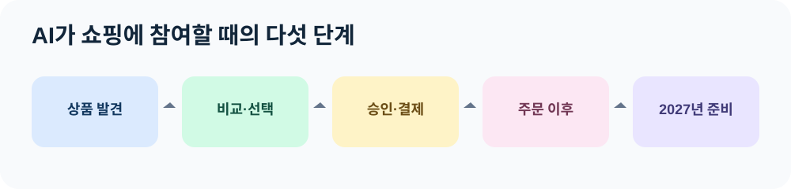

# 들어가며: AI에게 지갑을 맡기기 전에

“다음 주 회의에 쓸 무선 마이크를 찾아줘요. 예산은 20만 원이고, 금요일 전에 받아야 해요.”

예전의 AI라면 제품 몇 개를 추천하고 링크를 건네는 데서 멈췄을 것입니다. 이제는 상품 정보를 읽고, 배송 가능성을 비교하고, 결제 화면으로 이어 주는 흐름이 현실이 되었습니다. 다만 **어떤 단계까지 AI가 처리하고, 어떤 순간에 사람이 승인하는지**는 서비스마다 다릅니다. OpenAI가 2025년 공개한 Instant Checkout은 사용자가 구매를 확인하고 판매자가 주문·결제·배송을 처리하는 구조였습니다. [OpenAI의 설명](https://openai.com/index/buy-it-in-chatgpt/)

이 변화를 ‘에이전틱 커머스’라고 부릅니다. 낯선 이름이지만 출발점은 익숙합니다. 바쁜 사람을 대신해 조건에 맞는 물건을 찾는 구매 담당자를 떠올려 보세요. 담당자는 예산과 납기를 확인하고, 여러 제안을 비교하고, 권한이 없는 금액은 상사의 결재를 받습니다. AI에게 일을 맡길 때도 같은 질문이 필요합니다.

| 물어볼 것 | 생활 속 예 | AI에게 필요한 경계 |
| --- | --- | --- |
| 무엇을 사나 | 회의용 마이크 2개 | 정확한 규격과 수량 |
| 얼마까지 쓰나 | 총 20만 원 | 배송비·세금 포함 한도 |
| 언제 필요한가 | 금요일 전 | 실제 배송 가능일 확인 |
| 누가 확정하나 | 팀장 결재 | 결제 직전 승인 |
| 문제 생기면 | 교환·반품 요청 | 주문 기록과 판매자 연락 경로 |

표의 마지막 두 줄이 특히 중요합니다. 추천이 훌륭해도 잘못된 수량으로 결제하면 일이 끝난 것이 아닙니다. 거래 이후의 취소·반품·환불 경로까지 확인해야 구매를 위임했다고 말할 수 있습니다.

## 왜 지금 이 책인가

2026년에는 서로 다른 회사가 이 흐름의 각 부분을 구체화했습니다. Google은 판매자 상품 정보와 AI 쇼핑 접점을 확대했고, Visa는 승인된 기업 간 청구서 결제의 시범 운영을 발표했습니다. Mastercard는 에이전트가 디지털 서비스 이용료를 지불하는 시험을 공개했으며, Stripe는 에이전트를 통한 재무 업무 기능을 발표했습니다. 이것은 **업계의 방향을 보여 주는 근거**이지만, 모든 소비자가 지금 모든 기능을 쓸 수 있다는 뜻은 아닙니다. [Google](https://blog.google/products-and-platforms/products/shopping/google-shopping-updates-holiday-shopping/) · [Visa](https://usa.visa.com/about-visa/newsroom/press-releases.releaseId.22856.html) · [Mastercard](https://www.mastercard.com/global/en/news-and-trends/press/2026/october/Mastercard-Agent-Pay-for-Machines-in-action.html) · [Stripe](https://stripe.com/en-de/newsroom/news/treasury-for-agents)

## 2027년을 읽는 방법

이 책은 **2026년 11월 9일에 확인할 수 있는 사실**을 기준으로 씁니다. 2027년은 이 흐름이 어디로 갈지 살펴보는 시간표입니다. 예를 들어 AI가 결제할 수 있는 영역이 넓어질 수 있지만, 승인 절차·지역·판매자 참여·표준 연결 방식은 앞으로 달라질 수 있습니다. 확정된 기능과 전망을 구분하면서 읽어 주세요.

처음 다섯 장에서는 AI가 상품을 어떻게 발견하고 선택하는지 봅니다. 다음 다섯 장에서는 구매 권한, 결제, 주문 이후의 책임을 다룹니다. 마지막에는 판매자와 소비자가 각각 준비할 점, 조직의 작은 시험 계획, 2027년에 지켜볼 지표를 정리합니다. 기술을 외우기보다 **내가 무엇을 위임하고 무엇을 확인해야 하는지** 알게 되는 것이 이 책의 목표입니다.

*그림: 이 책의 읽기 경로. 자체 제작 도식.*
