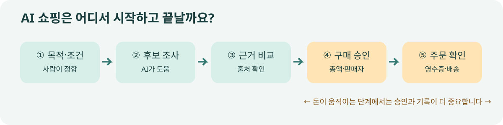

# 01. 왜 AI가 쇼핑을 시작했을까요?

> **확인 기준: 2026년 11월 9일.** 이 책에서 말하는 2027년은 확정된 미래가 아니라, 현재 공개된 서비스와 시범 운영을 바탕으로 준비할 질문입니다. 제품 기능과 지원 국가는 바뀔 수 있습니다.

새 직원에게 “우리 팀이 쓸 노트북을 사 주세요”라고 말한다고 가정해 보겠습니다. 바로 결제하라고 하지는 않을 것입니다. 먼저 누가 쓸지, 예산은 얼마인지, 어떤 프로그램을 돌릴지, 배송이 언제 필요한지를 함께 정할 것입니다. 직원은 후보를 찾고 비교할 수 있지만, 발주와 결제 전에는 담당자의 확인을 받아야 합니다.

AI 쇼핑도 이와 비슷합니다. 예전에는 사람이 검색어를 바꿔 가며 여러 쇼핑몰을 오갔습니다. 이제는 “출장이 잦은 팀원 다섯 명이 쓸 가벼운 노트북을 찾아 줘. 총예산은 700만 원이고, 국내 수리 가능 여부를 꼭 확인해 줘”라고 말할 수 있습니다. AI가 요구 조건을 풀어 보고 후보를 비교한 다음, 사람에게 결정할 부분을 되돌려 줄 수 있습니다.

2026년의 공식 발표를 보면 이런 변화가 단순한 구호에 머무르지는 않습니다. OpenAI는 ChatGPT에서 상품을 대화로 탐색하고 시각적으로 비교하는 기능을 소개했고, 판매자가 최신 상품 정보를 제공하는 경로도 넓혔습니다. Google은 검색의 AI Mode와 Gemini를 위한 쇼핑·장바구니·결제 연결을 발표했습니다. 다만 발표된 기능의 이용 범위는 국가와 판매자에 따라 다릅니다. [OpenAI의 상품 탐색 발표](https://openai.com/index/powering-product-discovery-in-chatgpt/) · [Google의 Universal Cart 발표](https://blog.google/products-and-platforms/products/shopping/google-shopping-cart/)

## 검색이 없어지는 것이 아니라, 검색 다음 단계가 붙습니다

| 사람이 하던 일 | AI가 도울 수 있는 일 | 끝까지 사람이 확인할 일 |
| --- | --- | --- |
| 필요한 물건을 말로 정리 | 용도·예산·제약 조건을 질문으로 구체화 | 진짜 필요한 조건인지 판단 |
| 여러 판매 페이지 탐색 | 후보를 모아 같은 기준으로 비교 | 출처와 최신 정보 확인 |
| 장바구니 구성 | 색상·크기·수량을 맞춰 초안 생성 | 잘못된 옵션과 중복 구매 확인 |
| 주문·결제 | 허용된 범위에서 절차 진행 | 금액·판매자·배송지 승인 |
| 배송 후 문제 처리 | 주문 상태 파악과 문의 초안 작성 | 환불·분쟁의 최종 결정 |

표의 왼쪽에서 오른쪽으로 갈수록 실수 비용이 커집니다. 후보 하나를 잘못 제안하면 다시 찾으면 됩니다. 잘못된 주소로 결제까지 했다면 취소, 환불, 개인정보 수정이 뒤따릅니다. 따라서 “AI가 쇼핑한다”는 말은 모든 단계를 무조건 자동으로 실행한다는 뜻으로 읽으면 안 됩니다.

**그림 1-1.** 이 책의 기본 구매 흐름입니다. 자체 제작 도식입니다. 실제 서비스마다 화면과 승인 방식은 다릅니다.

## 왜 지금 이 이야기를 하나요?

서로 다른 회사가 같은 문제의 다른 조각을 다루고 있기 때문입니다. OpenAI와 Google은 상품 발견과 구매 화면을 넓히고 있습니다. Visa는 허가된 AI 에이전트가 기업의 청구서 결제를 진행하는 시범 운영을 공개했습니다. Mastercard는 에이전트가 데이터·연산 같은 디지털 서비스를 정해진 예산 안에서 구매하는 시험과 조기 접근을 발표했습니다. Stripe는 사업자가 에이전트의 금융 정보 접근과 행동 권한, 사람의 승인 시점을 정할 수 있는 기능을 발표했습니다. 이것들은 각각 제품 출시, 제한된 접근, 시범 운영으로 성격이 다릅니다. [Visa 시범 운영](https://usa.visa.com/about-visa/newsroom/press-releases.releaseId.22856.html) · [Mastercard 조기 접근](https://www.mastercard.com/global/en/news-and-trends/press/2026/october/Mastercard-Agent-Pay-for-Machines-in-action.html) · [Stripe Treasury for agents](https://stripe.com/en-de/newsroom/news/treasury-for-agents)

이 흐름에서 2027년의 핵심 질문은 “AI가 얼마나 빨리 살 수 있는가”가 아닙니다. **누구의 의도로, 어떤 정보에 근거해, 얼마까지, 누구에게 돈을 보낼 수 있는가**입니다. 같은 질문을 소비자, 판매자, 조직의 구매 담당자가 서로 다른 입장에서 해야 합니다.

## 이 책을 읽는 세 사람

| 독자 | 당장 궁금한 점 | 이 책에서 얻을 기준 |
| --- | --- | --- |
| 개인 구매자 | AI의 추천을 얼마나 믿을 수 있나요? | 조건·출처·최종 금액을 확인하는 법 |
| 판매·마케팅 담당자 | 우리 상품이 AI에게 제대로 보이나요? | 상품 정보와 정책을 정리하는 법 |
| 운영·구매 담당자 | 에이전트에게 어디까지 맡겨도 되나요? | 승인·한도·기록·분쟁 경계를 정하는 법 |

같은 상품이라도 세 사람의 성공 기준이 다릅니다. 구매자는 맞는 제품을 제때 받는 것이 중요합니다. 판매자는 재고와 가격이 정확히 전달되어야 합니다. 조직은 누가 승인했고 문제가 생겼을 때 무엇을 되돌릴 수 있는지를 알아야 합니다. 그래서 이 책은 특정 앱의 사용법보다 **거래의 전 과정**을 따라갑니다.

### 이번 장의 점검 질문

1. 내가 최근 산 물건 하나를 고르고, 구매 전 판단 기준을 세 가지 적어 보세요.
2. 그 기준 중 AI가 자료로 확인할 수 있는 것과 내가 직접 결정해야 하는 것을 나눠 보세요.
3. 결제 전 반드시 보아야 할 정보가 무엇인지 적어 보세요. 가격만 보지 말고 판매자, 수량, 배송·반품 조건도 포함해 보세요.

**기억할 것:** AI 쇼핑은 검색창이 대화창으로 바뀌는 일에서 시작하지만, 구매와 결제까지 이어지면 권한·승인·책임의 문제로 확장됩니다.
