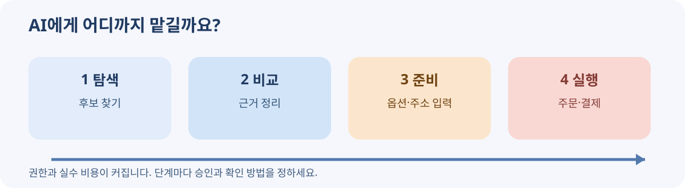

# 02. 에이전틱 커머스란 무엇인가요?

> **확인 기준: 2026년 11월 9일.** 용어와 구현은 회사마다 다릅니다. 이 장의 구분은 독자가 실제 업무를 판단하기 위한 설명 틀입니다.

“가장 싼 운동화를 찾아 줘”와 “내 대신 운동화를 사 줘”는 비슷하게 들리지만, 두 번째에는 돈과 주소가 들어갑니다. AI가 상품을 **추천**하는 것과 AI에게 **행동을 맡기는 것** 사이에는 큰 경계가 있습니다.

에이전틱 커머스는 AI 에이전트가 사람이나 조직의 목적과 허용 범위에 따라 상품·서비스를 찾고, 비교하고, 거래 절차의 일부를 수행하는 상거래 방식입니다. 여기서 ‘에이전틱’은 AI가 목표를 받고 여러 단계를 이어서 수행한다는 뜻입니다. 그렇다고 AI가 독립적인 구매자가 되거나 모든 결정을 스스로 내려야 한다는 뜻은 아닙니다.

## 네 단계로 이해하면 쉽습니다

| 단계 | 사용자가 말하는 예 | AI가 하는 일 | 실제 위험 |
| --- | --- | --- | --- |
| 1. 탐색 | “후보를 찾아 줘” | 상품·판매자 조사 | 낡은 정보, 빠진 후보 |
| 2. 비교 | “내 조건에 맞춰 골라 줘” | 근거를 같은 표로 정리 | 잘못된 비교 기준 |
| 3. 준비 | “주문서를 작성해 줘” | 옵션·수량·배송지 입력 초안 | 다른 상품, 다른 주소 |
| 4. 실행 | “승인한 조건으로 결제해 줘” | 허가된 거래 수행 | 금전 손실, 취소·환불 문제 |

1단계와 2단계는 답변의 품질이 주된 문제입니다. 3단계부터는 정보 입력의 정확도가 중요해집니다. 4단계에서는 그동안 정한 조건이 실제 결제와 영수증에 반영되었는지 확인해야 합니다. 이 단계를 건너뛰고 “AI가 다 알아서 샀다”고만 말하면 어느 지점에서 사람이 동의했는지 알기 어렵습니다.

## 누가 무엇을 책임지나요?

| 역할 | 주로 맡는 일 | 확인할 질문 |
| --- | --- | --- |
| 구매자 또는 발주자 | 목적·예산·금지 조건 설정, 중요한 행동 승인 | 이 거래를 정말 원했나요? |
| AI 에이전트 | 조건 해석, 정보 수집, 절차 준비 또는 실행 | 설정한 범위만 사용했나요? |
| 판매자 | 실제 상품, 가격, 재고, 배송·반품 조건 제공 | 제안과 실제 주문 조건이 같은가요? |
| 거래 플랫폼 | 상품 표시와 구매 흐름 연결 | 광고와 일반 결과를 구분할 수 있나요? |
| 결제 제공자 | 승인된 결제 수단으로 거래 처리 | 금액과 사용 범위가 맞나요? |

이 표는 법적 책임을 일괄적으로 정한 표가 아닙니다. 실제 책임은 거래 구조, 계약, 적용 법률에 따라 달라집니다. 이 책에서는 먼저 **업무상 누가 어떤 정보를 확인해야 하는지**를 나누기 위해 사용합니다.

OpenAI의 Agentic Commerce Protocol(ACP) 문서는 상품 정보 제공, 주문·결제 흐름을 나누어 설명합니다. Google의 Universal Commerce Protocol(UCP)은 발견부터 구매 후 지원까지 연결하는 공통 언어를 목표로 제시합니다. 두 이름이 비슷하더라도 같은 규격은 아닙니다. 독자는 이름을 외우기보다 **상품 정보를 전달하는 단계, 주문 내용을 확정하는 단계, 돈을 처리하는 단계**가 서로 구별된다는 점을 먼저 이해하면 됩니다. [OpenAI ACP 개요](https://developers.openai.com/commerce) · [Google UCP 발표](https://blog.google/products/ads-commerce/agentic-commerce-ai-tools-protocol-retailers-platforms/)

**그림 2-1.** 거래에 참여하는 사람과 시스템의 기본 관계입니다. 자체 제작 도식이며 특정 회사의 기술 구조를 그대로 나타낸 그림은 아닙니다.

## 주문을 ‘대신’한다는 말의 세 가지 뜻

일상에서는 모두 “대신 주문했다”고 말하지만, 실제로는 다릅니다.

첫째, **추천만 대신**할 수 있습니다. AI가 상품 링크와 비교표를 만들고 사람은 판매자 사이트에서 직접 결제합니다. 둘째, **입력을 대신**할 수 있습니다. AI가 장바구니나 결제 화면을 채우되 사람의 최종 확인이 필요합니다. 셋째, **승인된 조건 안에서 실행**할 수 있습니다. 사람이나 조직이 미리 정한 한도, 품목, 판매자, 기간 안에서 에이전트가 거래를 진행합니다. 이 셋을 혼동하면 사용자가 기대한 권한과 실제 권한이 달라집니다.

특히 “월 10만 원 이하”라는 한도만으로는 충분하지 않습니다. 9만 원짜리 물건을 열 번 사도 되는지, 특정 상점만 허용할지, 정기 구독을 허용할지, 배송지를 바꿀 수 있는지까지 정해야 합니다. 자세한 승인과 결제 설계는 뒤의 장에서 다룹니다.

## 2027년을 읽는 기준

이 책은 “2027년에는 모든 구매가 자동화된다”고 예언하지 않습니다. 2026년 말 현재, 상품 데이터 전달과 대화형 발견은 비교적 구체적인 문서와 제품 사례가 있습니다. 반면 자율 결제는 제공자·시장·이용자에 따라 제한되고, 일부는 시범 운영입니다. 따라서 2027년 전망은 **확인된 기반 위에 어디까지 확장될 수 있는지**를 묻는 방식으로 다룹니다. 예를 들어 Visa의 기업 간 청구서 결제 사례는 ‘시범 운영’이고, Mastercard의 기계 간 결제는 ‘조기 접근’입니다. [Visa 시범 운영](https://usa.visa.com/about-visa/newsroom/press-releases.releaseId.22856.html) · [Mastercard 조기 접근](https://www.mastercard.com/global/en/news-and-trends/press/2026/october/Mastercard-Agent-Pay-for-Machines-in-action.html)

### 이번 장의 점검 질문

1. AI에게 맡기려는 일을 네 단계 중 어디까지로 정할지 적어 보세요.
2. “승인”이 필요한 지점이 상품 선택인지, 주문서 작성인지, 결제 직전인지 정해 보세요.
3. 문제가 생기면 어느 기록으로 사실을 확인할지 생각해 보세요.

**기억할 것:** 에이전틱 커머스의 핵심은 AI가 거래의 여러 단계를 이어서 돕는 데 있습니다. 단계마다 권한과 확인 방법을 분리해야 실제로 믿고 사용할 수 있습니다.
