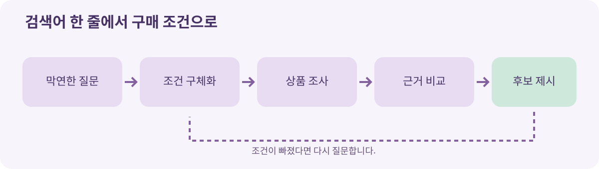

# 03. 검색에서 대화로 바뀌는 상품 발견

> **확인 기준: 2026년 11월 9일.** 아래 제품 사례의 이용 가능 지역과 판매자 범위는 달라질 수 있습니다.

동료가 “허리가 아파서 오래 앉아도 편한 의자를 사고 싶다”고 말하면, 능숙한 판매 직원은 곧바로 제품명부터 외치지 않습니다. 하루 몇 시간 앉는지, 책상 높이는 어떤지, 조절 기능이 중요한지, 예산은 얼마인지 묻습니다. 상품을 잘 찾는 일은 검색어를 빨리 입력하는 일보다 **질문을 제대로 만드는 일**에 가깝습니다.

AI가 쇼핑 대화를 시작하면 이 과정이 화면 안으로 들어옵니다. 사용자의 첫 문장은 “의자 추천해 줘”처럼 모호할 수 있습니다. AI가 사용 맥락을 묻고, 조건이 정해지면 후보를 찾고, 사용자가 조건을 바꾸면 결과를 다시 좁힙니다. OpenAI는 2026년 3월 상품 발견 기능을 확대하며 대화 중 상품을 시각적으로 비교하는 경험을 발표했습니다. Google도 AI Mode의 쇼핑 경험과 판매자 연결을 넓히고 있습니다. [OpenAI 상품 발견 발표](https://openai.com/index/powering-product-discovery-in-chatgpt/) · [Google AI 쇼핑 도구 발표](https://blog.google/products/ads-commerce/agentic-commerce-ai-tools-protocol-retailers-platforms/)

## 한 단어에서 구매 조건으로

| 첫 질문 | 대화로 드러낼 조건 | 비교할 수 있는 형태 |
| --- | --- | --- |
| “의자 추천해 줘” | 장시간 사용, 체형, 책상 높이 | 조절 범위, 크기, 보증 기간 |
| “팀 회의실 화면이 필요해” | 방 크기, 시청 거리, 연결 기기 | 화면 크기, 단자, 설치 방식 |
| “부모님 선물” | 취향, 사용 난이도, 배송 기한 | 사용 조건, 교환 정책, 배송일 |

대화의 목적은 긴 문장을 만드는 것이 아닙니다. **구매 결정을 바꿀 조건**을 찾는 것입니다. 예컨대 회의실 화면은 사진으로는 비슷해 보여도 연결 단자가 맞지 않으면 쓸 수 없습니다. AI가 그 조건을 질문하지 않았다면, 추천 순위가 아무리 그럴듯해도 중요한 일을 빠뜨린 셈입니다.

## 발견 경로가 여러 개라는 점을 기억하세요

AI가 상품을 보여 주는 방식은 하나가 아닙니다. 공개 웹페이지를 참고할 수 있고, 판매자가 제공한 상품 데이터로 최신 재고와 옵션을 읽을 수도 있습니다. 광고가 별도 위치에 표시될 수도 있습니다. OpenAI의 쇼핑 도움말은 상품 결과와 광고를 구분한다고 설명하고, 판매자 선정에는 가격·재고·품질 같은 정보를 고려한다고 안내합니다. Google은 AI Mode 안의 광고를 ‘Sponsored’로 표시한다고 밝혔습니다. 이 설명은 각 회사가 **자기 서비스에 대해** 밝힌 방식이며, 모든 플랫폼의 공통 규칙은 아닙니다. [OpenAI 쇼핑 결과 도움말](https://help.openai.com/en/articles/11128490-improved-shopping-results-from-chatgpt-search) · [Google AI Mode 광고 확대 발표](https://blog.google/products/ads-commerce/ads-in-ai-mode-global/)

**그림 3-1.** 대화형 상품 발견의 반복 과정입니다. 자체 제작 도식입니다.

## 추천 문장을 읽을 때 확인할 네 가지

**첫째, 기준이 보이는가요?** “이 제품이 최고입니다”라는 말보다 “수리 가능 기간과 배송일을 우선했고, 가격은 세 번째로 보았습니다”라는 설명이 낫습니다. 기준이 보이면 사용자가 가중치를 바꿀 수 있습니다.

**둘째, 출처가 확인되는가요?** 소재, 크기, 호환성, 가격, 재고는 판매자나 제조사의 최신 정보를 확인해야 합니다. OpenAI도 쇼핑 조사 기능이 가격·재고 같은 세부 사항을 틀릴 수 있으므로 판매자 사이트에서 다시 확인하라고 안내합니다. [OpenAI 쇼핑 조사 소개](https://openai.com/index/chatgpt-shopping-research/)

**셋째, 빠진 조건이 없는가요?** 사용자가 말하지 않았지만 반드시 필요한 조건이 있습니다. 선물이라면 배송 기한, 기업용 장비라면 설치 지원, 식품이라면 알레르기 정보가 그 예입니다. AI가 “추가 확인이 필요합니다”라고 말할 수 있어야 좋은 조사입니다.

**넷째, 광고와 일반 결과를 구분할 수 있나요?** 광고가 있다는 사실만으로 나쁜 추천은 아닙니다. 다만 돈을 내고 노출된 제안인지, 사용자 조건에 따른 일반 결과인지 알아야 판단할 수 있습니다. 라벨을 보고, 가능하다면 다른 판매자와 같은 기준으로 다시 비교하세요.

## 판매자에게는 무슨 변화가 생기나요?

예전에는 키워드 검색에서 눈에 띄는 제목과 광고 집행이 중요한 출발점이었습니다. 대화형 검색에서는 “작은 방, 반려동물 털, 야간 소음, 일주일 내 배송”처럼 조건이 조합됩니다. 판매자는 상품명만 길게 쓰기보다 실제 규격, 옵션, 배송·반품 조건을 구분해 제공해야 합니다. Google의 Merchant Center 도움말은 대화형 쇼핑에서 많이 묻는 상품 특성과 누락된 속성을 살펴보는 기능을 안내합니다. 해당 기능은 2026년 11월 확인 시 영어 검색어와 일부 국가 계정에 한정되어 있습니다. [Google Merchant Center AI 성과 인사이트](https://support.google.com/merchants/answer/17200695)

### 직접 해 보는 비교 연습

하나의 물건을 정하고 다음 순서로 질문해 보세요.

1. 처음에는 짧게 요청합니다. 예: “재택근무용 의자를 추천해 주세요.”
2. 이어서 예산·공간·배송 기한을 추가합니다.
3. 추천이 바뀌었다면 **어느 조건 때문에** 바뀌었는지 묻습니다.
4. 최종 후보 두 개의 규격과 가격을 판매자 원문에서 확인합니다.
5. 확인되지 않은 항목은 ‘추정’으로 따로 표시합니다.

이 연습의 성과는 물건을 바로 사는 데 있지 않습니다. AI가 어떤 질문을 놓쳤고, 어떤 근거는 직접 확인해야 하는지 배우는 데 있습니다.

**기억할 것:** 대화형 상품 발견은 검색 결과를 없애는 기술이 아니라, 구매 목적을 조건으로 바꾸고 여러 정보를 비교하는 과정입니다. 좋은 추천은 순위보다 **기준·출처·누락 사항**이 잘 보입니다.
