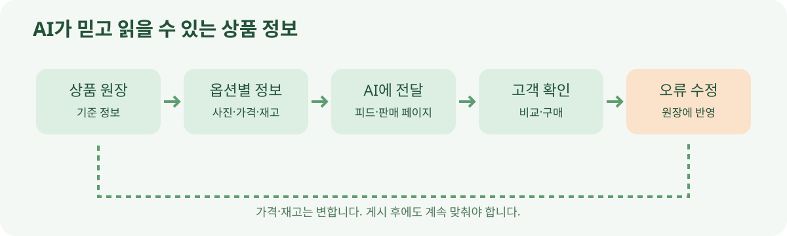

# 04. AI가 읽을 수 있는 상품 정보 만들기

> **확인 기준: 2026년 11월 9일.** 플랫폼별 필수 항목과 제공 방식은 다르며 앞으로 바뀔 수 있습니다. 여기서는 비개발자가 관리해야 할 정보의 품질에 집중합니다.

가게 직원에게 “파란색 컵은 300mL인데 사진은 빨간색이고, 가격표는 지난달 것이에요”라고 적힌 재고표를 주면 좋은 추천을 기대하기 어렵습니다. AI도 마찬가지입니다. 화려한 설명보다 **같은 상품을 정확하게 가리키는 정보**가 필요합니다.

판매자가 AI 쇼핑 환경에 제공하는 정리된 상품 목록을 보통 상품 피드(product feed)라고 부릅니다. OpenAI는 ChatGPT의 상품 발견용 피드에서 품목 식별자, 이름, 설명, 상품 URL, 브랜드, 판매자, 이미지, 재고 상태, 가격을 기본 항목으로 문서화합니다. 옵션별로 살 수 있는 상품은 행을 나누고, 가격과 재고도 옵션별로 맞추도록 안내합니다. 이 문서의 필드 이름을 모든 플랫폼의 공통 규칙으로 옮겨 쓰면 안 됩니다. [OpenAI 상품 피드 사양](https://developers.openai.com/commerce/specs/file-upload/products)

## 고객의 질문으로 다시 보는 상품 정보

| 고객이 묻는 말 | 판매자가 정리할 정보 | 흔한 오류 |
| --- | --- | --- |
| “정확히 어떤 제품인가요?” | 안정적인 품목 번호, 모델명, 제조사 | 다른 상품에 같은 번호 재사용 |
| “제가 고른 색과 크기가 맞나요?” | 옵션별 이름·사진·주소 | 검정 상품에 파란 사진 사용 |
| “지금 살 수 있나요?” | 옵션별 재고 상태 | 품절인데 ‘재고 있음’ 유지 |
| “얼마를 내나요?” | 통화, 현재 가격, 할인 조건 | 광고 가격과 결제 가격 불일치 |
| “언제 받을 수 있나요?” | 배송 범위·비용·예상 일정 | 무료 배송이라고 오해할 빈칸 |
| “마음에 안 들면요?” | 교환·반품 정책, 판매자 연락처 | 정책 링크가 깨짐 |

이 표는 개발팀에 넘길 데이터 항목 목록인 동시에, 고객 문의를 줄이는 운영 점검표입니다. 품목 번호가 안정적이어야 여러 번 갱신해도 같은 상품을 알아볼 수 있습니다. 색상별 재고를 따로 써야 ‘검정은 품절, 파랑은 재고 있음’을 정확히 전달할 수 있습니다. 배송비가 비어 있다면 무료라는 뜻인지 정보가 없는 것인지 구별해야 합니다.

## 상품 설명은 사실을 쓰고, 판단은 독자에게 남깁니다

“세상에서 가장 편한 의자”는 광고 문구로 쓸 수 있지만, AI가 고객의 조건과 대조하기에는 부족합니다. “좌석 높이 42~52cm 조절, 최대 하중 110kg, 등받이 기울기 조절, 조립 필요”는 확인 가능한 정보입니다. OpenAI의 피드 모범 사례도 간결하고 사실적인 설명, 정확한 옵션 정보, 유효한 링크를 권합니다. [OpenAI 상품 피드 모범 사례](https://developers.openai.com/commerce/guides/best-practices)

다음은 **교육용 가상 사례**입니다. 실제 상품이 아닙니다.

| 구분 | 수정 전 | 수정 후 |
| --- | --- | --- |
| 상품명 | “프리미엄 만능 텀블러” | “스테인리스 텀블러 500mL, 흰색” |
| 설명 | “어디서나 최고!” | “보온·보냉용 이중벽, 손세척 권장” |
| 옵션 | “여러 색상” | “흰색·검정, 색상별 상품 번호” |
| 재고 | “판매 중” | “흰색 재고 있음, 검정 일시 품절” |
| 정책 | “교환 가능” | “수령 후 교환 신청 조건·연락처 링크” |

수정 후 정보가 길거나 화려해서 좋은 것이 아닙니다. 고객이 실제로 고르는 단위인 색상과 용량을 명시했고, 없는 재고를 없다고 썼기 때문입니다. AI는 없는 사실을 채워 넣기보다 “정책이 확인되지 않습니다”라고 말해야 합니다.

**그림 4-1.** 정보가 고객에게 도달하고 오류가 다시 원장으로 돌아오는 순환입니다. 자체 제작 도식입니다.

## 한 번 올리고 끝나는 일이 아닙니다

가격, 재고, 배송 가능 지역은 자주 바뀝니다. OpenAI의 파일 업로드 안내는 전체 상품 목록을 반복적으로 갱신하는 방식을 설명하며 최소 일 단위 갱신을 권합니다. 하지만 품절이 빠르게 바뀌는 상품이라면 실제 결제 직전에 판매자의 최신 상태를 다시 확인하는 절차가 필요합니다. Google은 UCP의 Catalog 기능으로 옵션, 재고, 가격 같은 실시간 세부 정보를 필요할 때 조회하는 방향을 발표했습니다. 여기서 ‘발표’와 모든 판매자에게 실제 제공되는 상태는 구분해야 합니다. [OpenAI 피드 전달 안내](https://developers.openai.com/commerce/specs/file-upload/overview) · [Google UCP 기능 업데이트](https://blog.google/products-and-platforms/products/shopping/ucp-updates/)

### 운영 담당자의 주간 점검표

1. 가장 많이 팔리는 상품 10개의 가격·재고·대표 사진을 실제 판매 페이지와 대조합니다.
2. 색상·크기별 품목 번호가 겹치지 않는지 확인합니다.
3. 배송·반품 정책 링크를 직접 열어 봅니다.
4. 품절·단종 상품이 AI용 데이터에 남아 있는지 확인합니다.
5. AI가 보여 준 잘못된 정보가 있다면, AI 화면만 수정할지 원장도 수정해야 할지 구분합니다.

**기억할 것:** AI에게 잘 보이기 위한 첫 작업은 문구를 꾸미는 일이 아닙니다. 고객이 실제로 구매하는 옵션마다 **정확하고 갱신 가능한 사실**을 제공하는 일입니다.
