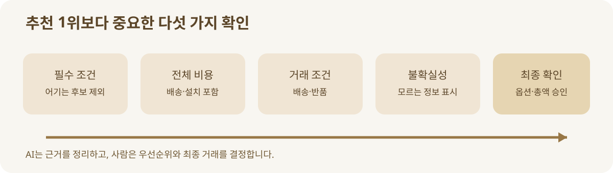

# 05. 추천과 비교는 무엇을 기준으로 해야 할까요?

> **확인 기준: 2026년 11월 9일.** 아래 점수표는 판단을 연습하기 위한 교육용 예시이며 특정 플랫폼의 추천 알고리즘을 뜻하지 않습니다.

사무실용 공기청정기를 고를 때 ‘인기 순위 1위’만 보면 충분할까요? 어떤 팀은 소음이 가장 중요하고, 어떤 팀은 필터 구매 비용이나 설치 공간이 더 중요합니다. “좋은 상품”은 하나로 정해져 있지 않습니다. **누구의 어떤 상황에 좋은가**를 먼저 밝혀야 합니다.

AI가 여러 제품을 빠르게 읽고 비교하더라도, 목적이 흐리면 잘못된 기준으로 빠르게 답할 뿐입니다. 특히 가격은 표시된 숫자 하나가 아닙니다. 배송비, 설치비, 정기 소모품, 반품 비용이 더해질 수 있습니다. 신뢰할 만한 추천은 숨은 비용과 모르는 정보도 함께 표시해야 합니다.

## 우선순위를 먼저 정합니다

교육용 가상 사례를 보겠습니다. 세 후보 모두 가상의 공기청정기입니다.

| 기준 | A | B | C | 이번 구매의 우선순위 |
| --- | --- | --- | --- | --- |
| 본체 가격 | 18만 원 | 22만 원 | 25만 원 | 중간 |
| 배송 예상 | 2일 | 5일 | 2일 | 높음 |
| 사용 공간 | 15㎡ | 25㎡ | 20㎡ | 20㎡ 이상 필요 |
| 연간 필터 비용 | 확인 필요 | 4만 원 | 7만 원 | 중간 |
| 반품 조건 | 미확인 | 수령 후 7일 | 수령 후 7일 | 높음 |

A는 가장 저렴하지만 필요한 공간 조건을 충족하지 못합니다. B는 조건을 맞출 가능성이 있지만 배송이 늦습니다. C는 비싸지만 배송은 빠릅니다. 여기서 AI가 무조건 C를 ‘최고’라고 부르기보다, “이번 주에 설치해야 한다면 C, 다음 주까지 기다릴 수 있다면 B”라고 설명하는 편이 정확합니다. A의 필터 비용과 반품 조건은 확인되지 않았으므로 임의로 채우면 안 됩니다.

## 세 가지 다른 숫자를 섞지 않습니다

| 숫자 | 뜻 | 주의할 점 |
| --- | --- | --- |
| 표시 가격 | 상품 페이지에서 보이는 가격 | 시점·옵션·통화에 따라 달라짐 |
| 예상 총비용 | 배송·설치·반복 비용까지 합친 값 | 입력값이 빠지면 비교가 왜곡됨 |
| 결제 직전 총액 | 실제 선택 옵션과 주소에 따른 최종 금액 | 주문 화면에서 다시 확인해야 함 |

예상 총비용은 의사결정용 계산이고, 결제 직전 총액은 실제 거래의 확인 값입니다. 둘이 다르면 이유를 알아야 합니다. 할인 종료, 배송지 변경, 품목 옵션 변경, 세금·수수료 등 다양한 원인이 있을 수 있습니다. 실제 결제 전에는 **선택 옵션·수량·판매자·총액**을 한 화면에서 확인하는 습관이 필요합니다.

**그림 5-1.** 후보를 고르는 순서입니다. 자체 제작 도식입니다.

## 추천에는 정보의 출처가 따라야 합니다

AI가 “B가 더 조용합니다”라고 말했는데 제조사 규격표에는 소음 수치가 없을 수 있습니다. 리뷰에서 몇 사람이 조용하다고 쓴 것인지, 공식 시험 수치인지에 따라 말의 무게가 달라집니다. 그래서 추천 문장을 읽을 때는 정보를 다음처럼 나누는 것이 좋습니다.

| 표시 | 의미 | 독자의 행동 |
| --- | --- | --- |
| 공식 규격 | 제조사·판매자가 공개한 사양 | 모델·옵션과 시점 확인 |
| 판매 조건 | 가격·재고·배송·반품 | 주문 직전 다시 확인 |
| 이용 후기 | 일부 구매자의 경험 | 표본·편향·사용 환경 고려 |
| AI의 추론 | 여러 정보를 묶은 판단 | 근거와 빠진 조건 질문 |

OpenAI는 쇼핑 조사 기능이 가격·재고 등 상품 세부 정보를 틀릴 수 있다고 안내합니다. 따라서 AI의 종합 의견을 참고하되, 거래를 바꾸는 사실은 원문에서 확인해야 합니다. [OpenAI 쇼핑 조사 소개와 한계](https://openai.com/index/chatgpt-shopping-research/)

## 광고와 협력 관계도 판단 자료입니다

상품을 발견하는 화면에는 일반 결과와 광고가 함께 있을 수 있습니다. OpenAI는 자사 쇼핑 상품 결과가 광고와 별개라고 설명하고, Google은 AI Mode의 광고를 ‘Sponsored’로 표시한다고 발표했습니다. 플랫폼마다 설계가 다르므로 독자는 현재 사용하는 화면의 라벨과 안내를 확인해야 합니다. 광고라서 무조건 배제할 필요도, 잘 보인다는 이유로 그대로 선택할 필요도 없습니다. 추천의 **기준과 거래 조건**으로 판단해야 합니다. [OpenAI 쇼핑 결과 도움말](https://help.openai.com/en/articles/11128490-improved-shopping-results-from-chatgpt-search) · [Google AI Mode 광고 안내](https://blog.google/products/ads-commerce/ads-in-ai-mode-global/)

## AI에게 이렇게 다시 물어보세요

“어느 것이 최고인가요?” 대신 다음 질문이 유용합니다.

1. “내 필수 조건을 하나라도 어기는 후보를 먼저 제외해 주세요.”
2. “가격을 본체·배송·설치·소모품으로 나눠 주세요. 모르면 모른다고 표시해 주세요.”
3. “각 후보를 고른 근거의 원문을 보여 주세요.”
4. “추천이 바뀔 수 있는 조건 두 가지를 알려 주세요.”
5. “지금 결제한다면 다시 확인해야 할 값은 무엇인가요?”

이 질문은 AI가 같은 결론을 더 그럴듯하게 반복하게 하려는 것이 아닙니다. 비교의 **빈칸과 가정**을 드러내기 위한 것입니다. 그 빈칸을 메운 뒤에도 두 후보가 비슷하다면, 선택은 결국 사용자의 선호입니다.

### 이번 장의 연습

최근 실제로 샀거나 살 예정인 물건 하나를 골라 필수 조건 세 개와 선호 조건 세 개를 적어 보세요. 후보 두 개를 찾고, ‘확인된 사실’과 ‘내 판단’을 다른 칸에 써 보세요. 결제 직전에는 처음 본 가격과 최종 금액이 같은지 비교하세요.

**기억할 것:** AI의 추천은 결정을 대신 끝내는 문장이 아니라, 조건과 근거를 정리해 사람이 더 잘 선택하도록 돕는 과정입니다.
