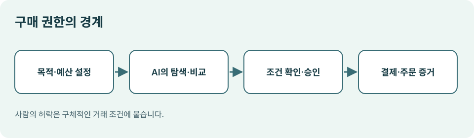

# 06. 구매 위임과 사람의 승인

> 확인일: 2026년 11월 9일. 이 장의 2027년 이야기는 현재 서비스의 기능이 아니라, 실무자가 준비할 운영 원칙입니다.

## 장면: “괜찮은 걸로 하나 사 줘”

팀장이 행사 기념품을 주문하라고 했습니다. 담당자는 예산 100만 원, 참석자 50명, 납기 2주라는 조건을 AI에 줍니다. AI가 후보를 찾고 가격을 비교하는 데까지는 큰 이견이 없습니다. 그런데 AI가 “괜찮은 걸로”라는 말을 구매 허락으로 해석해 결제까지 마친다면 어떨까요? 상품이 마음에 들더라도 수량, 배송일, 반품 조건을 확인할 기회를 잃습니다.

**구매 위임은 ‘목표를 알려 주는 일’과 ‘돈을 쓰도록 허락하는 일’을 구분하는 데서 시작합니다.** AI가 무엇을 할 수 있는지 정할 때는 업무 목적뿐 아니라 금액, 품목, 판매자, 기간, 승인자까지 적어야 합니다.

*그림: 이 책을 위해 직접 제작한 구매 권한의 경계 도식.*

| 단계 | AI에 맡길 수 있는 일 | 사람이 확인할 일 |
| --- | --- | --- |
| 탐색 | 조건에 맞는 상품과 판매자를 찾기 | 제외할 브랜드·이해관계 확인 |
| 비교 | 가격·납기·반품 조건을 한 표로 정리 | 우선순위와 최종 후보 결정 |
| 주문 준비 | 장바구니와 배송 정보를 작성 | 수량·총액·주소·약관 확인 |
| 결제 | 승인된 조건 안에서 결제 절차 수행 | 승인 또는 사전 위임 범위 설정 |
| 사후 처리 | 주문 상태 추적과 문제 알림 | 취소·환불·분쟁의 최종 판단 |

이 표에서 중요한 경계는 ‘결제 버튼’ 하나가 아닙니다. 주문 준비 중 주소나 수량이 바뀌어도 결과가 크게 달라집니다. 따라서 최종 승인은 **상품, 판매자, 수량, 배송지, 총 결제액**이 한눈에 보이는 상태에서 받아야 합니다.

## 승인 카드의 다섯 칸

다음은 조직에서 시험해 볼 수 있는 승인 카드의 예시입니다. 실제 서비스의 화면을 그대로 옮긴 것은 아닙니다.

| 항목 | 예시 |
| --- | --- |
| 목적 | 12월 고객 행사 기념품 구매 |
| 허용 범위 | 국내 판매자, 단가 2만 원 이하, 50개 이내 |
| 총액 상한 | 배송비·세금 포함 100만 원 |
| 마감 | 11월 20일 18시까지 |
| 실행 조건 | 구매 담당자 승인 후 1회 결제 |

‘100만 원까지 써도 된다’는 문장만으로는 부족합니다. AI가 1만 원짜리 물건을 100개 살 수도 있고, 배송비가 별도로 붙을 수도 있습니다. 승인 범위는 **거래당 한도와 전체 기간 한도**를 함께 적고, 주문이 변경되면 기존 승인을 다시 확인하도록 설계하는 편이 안전합니다.

## 승인에도 여러 수준이 있습니다

| 수준 | 예시 | 적합한 경우 |
| --- | --- | --- |
| 제안만 | AI가 비교표 작성 | 처음 도입하거나 고가 상품 |
| 주문 준비 | 장바구니까지 작성, 결제는 사람 | 반복 구매지만 조건이 자주 바뀜 |
| 조건부 실행 | 사전 승인한 품목·판매자·한도 안에서 실행 | 저위험 반복 거래 |
| 예외만 보고 | 정해진 범위를 벗어나면 중단 | 충분한 운영 기록이 쌓인 뒤 |

자율성은 한 번에 최대로 높이는 기능이 아닙니다. 처음에는 ‘제안만’으로 시작하고, 실제 비교 결과와 주문 오류를 기록한 뒤 범위를 넓히는 것이 좋습니다. 예외가 생겼는데 AI가 조용히 대체 상품을 결제한다면 승인 체계가 무너집니다.

구글은 Agent Payments Protocol(AP2)에서 사용자의 의도를 증명하는 방식과, 사전에 정한 조건에 따라 사람이 그 순간 자리에 없는 거래를 처리하는 방식을 설명합니다. 이는 모든 쇼핑 서비스에서 자동 구매가 이미 가능한 뜻은 아닙니다. 2026년 4월 공개된 AP2 0.2의 방향을 보여 주는 자료입니다. [Google의 AP2 설명](https://blog.google/products-and-platforms/platforms/google-pay/agent-payments-protocol-fido-alliance/)

## 승인 전에 볼 질문

1. 지금 결제하려는 상품과 처음 요청한 상품이 같은가요?
2. 할인 전 금액이 아니라 세금과 배송비를 포함한 총액이 보이나요?
3. 판매자와 최종 책임 주체가 누구인지 알 수 있나요?
4. 납기, 취소, 환불 조건이 확인되었나요?
5. 결제가 실패하거나 중복 시도될 때 멈추고 알려 주나요?

이 다섯 가지를 표시할 수 없다면 결제 권한을 넓히기보다 정보를 먼저 보완해야 합니다. 특히 ‘승인 요청을 보냈다’와 ‘승인을 받았다’는 서로 다른 상태입니다. 결제 시스템은 후자의 증거가 있을 때만 움직여야 합니다.

**이번 장의 핵심:** AI에게 탐색과 비교를 맡기는 것과 지출 권한을 주는 것은 별개의 결정입니다. 2027년 준비의 출발점은 구매 의도, 한도, 승인, 예외 처리의 기록을 분명히 만드는 일입니다.
