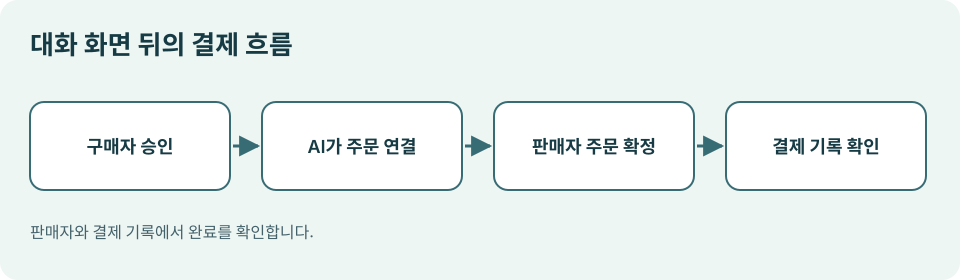

# 07. AI 결제의 흐름과 한도

> 확인일: 2026년 11월 9일. 제품별로 지원 국가와 참여 자격이 다르므로 실제 결제 가능 여부는 각 서비스에서 확인해야 합니다.

## 장면: 결제 창은 AI에 있는데 돈은 어디서 빠질까요?

대화 화면에서 추천받은 운동화를 골랐습니다. 같은 화면에서 결제까지 보입니다. 이때 화면을 제공한 AI 서비스가 판매자일까요? 반드시 그렇지는 않습니다. 주문을 접수하고 돈을 청구하며 배송할 주체는 따로 있을 수 있습니다.

결제 흐름을 이해할 때는 네 역할을 분리해 보세요.

*그림: 이 책을 위해 직접 제작한 결제 역할 도식.*

| 역할 | 하는 일 | 확인할 질문 |
| --- | --- | --- |
| 구매자 | 조건을 말하고 구매를 승인 | 내가 무엇을 허락했나? |
| AI 서비스 | 상품을 제시하고 주문 화면을 연결 | 조건을 정확히 전달했나? |
| 판매자 | 가격·재고·배송·주문을 확정 | 실제 판매자는 누구인가? |
| 결제 처리자 | 결제 수단을 안전하게 처리 | 청구·환불 경로는 어디인가? |

OpenAI의 Agentic Commerce Protocol(ACP) 문서에서는 ChatGPT 안에서 결제 화면이 표시되더라도 실제 주문 상태와 결제 처리는 판매자 시스템에서 이루어진다고 설명합니다. 판매자가 주문을 수락하거나 거절하고, 기존 결제 처리자를 통해 청구합니다. 또한 ChatGPT의 즉시 결제는 2026년 11월 9일 기준 **승인된 파트너에게 제공**된다고 명시합니다. [OpenAI ACP 핵심 개념](https://developers.openai.com/commerce/guides/key-concepts)

## 결제 수단을 통째로 맡기는 것은 아닙니다

위 ACP 문서는 ‘위임 결제’에서 금액 상한과 만료 시간이 있는 일회성 요청을 만들고, 신뢰된 결제 처리자가 토큰을 반환하는 흐름을 소개합니다. 토큰은 해당 거래에 필요한 결제 정보를 대신 전달하는 수단입니다. 이 설명은 **모든 에이전트 결제가 같은 방식으로 구현된다**는 뜻이 아닙니다. 서비스마다 사용 기술과 책임 구조를 확인해야 합니다. [OpenAI ACP 핵심 개념](https://developers.openai.com/commerce/guides/key-concepts)

| 통제 항목 | 왜 필요한가 | 예시 규칙 |
| --- | --- | --- |
| 건당 최대액 | 예상보다 비싼 상품 구매 방지 | 1회 10만 원 이하 |
| 기간 총액 | 작은 결제 여러 건의 누적 방지 | 월 30만 원 이하 |
| 사용처 | 허용하지 않은 판매자 차단 | 승인한 공급업체만 |
| 품목 | 목적 밖 지출 방지 | 사무용 소모품만 |
| 만료 | 오래된 지시의 재사용 방지 | 승인 후 30분 |
| 횟수 | 중복 주문 방지 | 주문번호당 1회 |

한도는 결제액만이 아니라 **수량과 횟수**에도 필요합니다. 9만 원짜리 물건을 세 번 사면 건당 10만 원 규칙은 통과하지만 월 총액은 넘어설 수 있습니다. 또 결제 실패 화면이 떠서 재시도했는데 첫 결제가 이미 성공했다면 중복 청구가 생길 수 있습니다.

## 승인·승인 요청·결제 완료는 다릅니다

독자가 주문 상태를 네 단계로 나눠 읽으면 혼란이 줄어듭니다.

1. **견적:** 화면에 예상 총액이 보입니다. 아직 돈이 나가지 않았습니다.
2. **승인:** 구매자가 조건과 금액을 허락합니다. 아직 주문이 확정되지 않을 수 있습니다.
3. **결제 처리:** 판매자와 결제 처리자가 승인·청구를 처리합니다.
4. **주문 확인:** 판매자가 주문번호와 확정 상태를 돌려줍니다.

OpenAI의 결제 사양은 주문 세션을 만들고 갱신한 뒤 완료하며, 판매자가 주문 이벤트로 상태를 갱신하는 구조를 설명합니다. 기술 세부를 외울 필요는 없습니다. **AI의 “샀습니다”라는 문장보다 판매자의 주문번호와 결제 기록을 우선 확인한다**는 원칙이 핵심입니다. [OpenAI 결제 사양](https://developers.openai.com/commerce/specs/checkout)

## 2027년을 준비하는 한 장짜리 정책

우리 조직에서 AI 결제 시험을 시작한다면 다음을 문서로 남겨 보세요.

| 질문 | 기록할 답 |
| --- | --- |
| 누가 승인하나요? | 금액별 승인 담당자 |
| 어디서 쓸 수 있나요? | 승인된 판매자와 품목 |
| 얼마까지 쓸 수 있나요? | 건당·월간·팀별 상한 |
| 무엇을 증거로 보나요? | 승인 기록, 주문번호, 영수증 |
| 언제 멈추나요? | 가격 변동, 재고 변경, 주소 변경, 재시도 |

이 정책은 결제 기술이 바뀌어도 유효합니다. 통제할 권한과 확인할 증거를 먼저 정하면 특정 서비스의 화면이 달라져도 질문을 다시 적용할 수 있습니다.

**이번 장의 핵심:** AI 화면에서 구매했다고 해서 AI 서비스가 판매자이거나 결제 책임자가 되는 것은 아닙니다. 돈의 흐름과 주문의 진실은 실제 판매자·결제 기록까지 확인해야 합니다.
