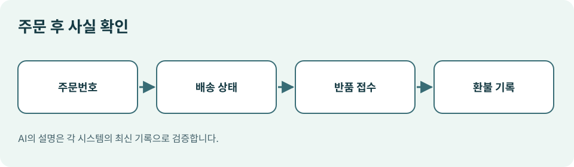

# 08. 주문·배송·반품에서 누가 책임지나

> 확인일: 2026년 11월 9일. 이 장은 일반적인 운영 설계 예시이며, 소비자 권리와 판매자의 의무는 거래 지역과 계약 조건에 따라 달라집니다.

## 장면: AI는 “배송 중”이라는데 택배가 오지 않습니다

AI가 주문한 물건의 상태를 묻자 “곧 도착합니다”라고 답합니다. 그러나 판매자 사이트에는 주소 확인이 필요하다고 표시됩니다. 두 화면이 다를 때 누구 말을 믿어야 할까요? 이 질문은 AI 쇼핑이 실제 상거래로 이어질수록 중요해집니다.

주문 이후에는 AI가 대화를 돕더라도 **판매자의 주문·배송 시스템이 확인 가능한 사실의 기준**입니다. OpenAI의 ACP 결제 사양도 판매자의 주문 생성·갱신 이벤트로 대화 화면의 상태를 맞추도록 설계합니다. 이는 상태 동기화가 중요한 운영 과제임을 보여 줍니다. [OpenAI 결제 사양](https://developers.openai.com/commerce/specs/checkout)

*그림: 이 책을 위해 직접 제작한 구매 후 확인 도식.*

| 사건 | AI가 도울 일 | 확인해야 할 공식 기록 | 담당 주체 |
| --- | --- | --- | --- |
| 주문 접수 | 주문번호 안내 | 판매자 주문 확인 | 판매자 |
| 재고 부족 | 대안 비교 | 품절 및 주문 변경 통지 | 판매자·구매자 |
| 배송 지연 | 배송 상태 요약 | 운송장·배송사 기록 | 판매자·배송사 |
| 반품 신청 | 절차와 기한 안내 | 판매자 반품 접수번호 | 판매자 |
| 환불 | 진행 상황 추적 | 결제 수단의 환불 내역 | 판매자·결제 처리자 |

표의 마지막 칸은 법적 책임을 단정하는 표가 아닙니다. 독자가 **어느 시스템에서 사실을 확인할지** 찾기 위한 운영 지도입니다. 계약이나 지역 법규에 따른 책임 판단은 별도 검토가 필요합니다.

## 주문 이후 정보가 끊기면 생기는 일

첫째, 배송지 변경이 AI 화면에 반영되지 않아 잘못된 주소로 갈 수 있습니다. 둘째, 판매자가 품절을 알렸는데 AI가 이전 재고 정보를 바탕으로 “출고 준비”라고 말할 수 있습니다. 셋째, 반품을 요청했다고 생각했지만 실제 판매자에게는 접수되지 않을 수 있습니다.

그래서 ‘말로 요청했다’와 ‘시스템에 접수되었다’를 구분해야 합니다. AI가 반품 신청을 대신할 때는 **접수 시각, 접수번호, 대상 주문번호, 상품 수량, 환불 예상 방식**을 받아 두는 편이 좋습니다. 하나라도 비어 있다면 완료라고 표현하지 않아야 합니다.

## 변경이 생겼을 때의 멈춤 규칙

| 변경 | 기본 동작 | 이유 |
| --- | --- | --- |
| 총액 증가 | 다시 승인 요청 | 이전 지출 허락 범위가 바뀜 |
| 다른 상품으로 대체 | 후보를 제시하고 대기 | 선호와 규격이 다를 수 있음 |
| 배송지 변경 | 본인 확인 후 수정 | 오배송과 개인정보 노출 위험 |
| 배송 지연 | 사실을 알리고 선택지 제시 | 구매 목적이 무의미해질 수 있음 |
| 반품 불가 통지 | 관련 조건과 원문 제시 | AI 요약만으로 판단하기 어려움 |

이 표는 자동화의 속도를 늦추기 위한 장식이 아닙니다. 변경된 조건이 **처음 허락한 거래와 같은 거래인지** 다시 판단하는 장치입니다. 위험이 작은 상태 조회는 자동으로 진행해도 되지만, 돈과 물건이 바뀌는 결정은 승인 경계를 되짚어야 합니다.

구글은 Universal Commerce Protocol(UCP)을 상품 발견부터 구매, 구매 후 지원까지 연결하는 표준으로 소개했습니다. 이는 2026년 1월 발표된 방향과 구현을 설명하는 말이며, 모든 판매자의 배송·반품 과정이 이미 통합되었다는 뜻은 아닙니다. 독자는 이용 중인 판매자가 실제로 제공하는 사후 지원 범위를 확인해야 합니다. [Google UCP 발표](https://blog.google/products/ads-commerce/agentic-commerce-ai-tools-protocol-retailers-platforms/)

## 작은 실습: 주문 추적 카드 만들기

주문 하나를 골라 아래 항목을 채워 보세요. 실제 결제 정보나 카드번호는 적지 않습니다.

| 항목 | 기록 |
| --- | --- |
| 판매자와 주문번호 |  |
| 상품·수량·확정 총액 |  |
| 예상 배송일과 출처 |  |
| 반품 가능 기한과 절차 |  |
| 고객센터 또는 문의 경로 |  |
| AI가 마지막으로 확인한 시각 |  |

마지막 줄이 중요합니다. AI의 답은 최신 사실을 조회한 결과일 수도 있고, 이전 대화의 기억일 수도 있습니다. **언제, 어디에서 확인했는지** 표시하면 두 경우를 구분할 수 있습니다.

**이번 장의 핵심:** 주문 이후 AI는 훌륭한 안내자가 될 수 있지만, 실제 접수·배송·환불의 증거는 해당 거래를 처리하는 시스템에서 확인해야 합니다.
