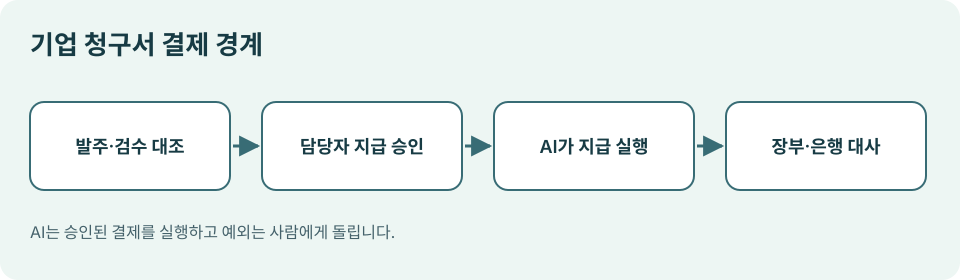

# 09. 기업 구매와 청구서 처리

> 확인일: 2026년 11월 9일. 기업 구매의 승인 절차는 회사와 산업에 따라 다릅니다. 아래 흐름은 설명용 사례입니다.

## 장면: 청구서는 승인됐는데 마지막 입력이 남았습니다

한 회사가 이미 검수와 결재를 마친 공급업체 청구서를 지급하려고 합니다. 그런데 공급업체 포털에 들어가 청구서 번호와 결제 정보를 다시 입력해야 합니다. 담당자는 매번 같은 단계를 반복합니다. AI가 이 마지막 단계를 수행한다면 업무는 빨라질 수 있습니다. 다만 **누가 지급을 결정했는지**가 흐려져서는 안 됩니다.

2026년 10월 비자, BILL, Billtrust는 구매자가 이미 승인한 청구서 결제를 AI 에이전트가 공급업체 포털에서 실행하는 실제 시범 운영을 발표했습니다. 비자의 설명에 따르면 이 시범 운영에서 AI는 결제 여부를 스스로 결정하지 않으며, 사전에 승인된 적격 결제만 수행합니다. 참여 회사의 시험 사례로 이해해야 하며 모든 기업에서 쓸 수 있는 일반 기능으로 받아들여서는 안 됩니다. [Visa·BILL·Billtrust 발표](https://usa.visa.com/about-visa/newsroom/press-releases.releaseId.22856.html)

*그림: 이 책을 위해 직접 제작한 기업 청구서 결제 도식.*

## 기업 구매의 기본 줄기

| 단계 | 확인할 자료 | AI에 맡길 수 있는 부분 | 사람이 남겨야 할 판단 |
| --- | --- | --- | --- |
| 요청 | 구매 목적과 예산 | 규격·후보 정리 | 구매 필요성 |
| 발주 | 승인된 공급업체와 조건 | 발주서 초안 | 공급업체 선정 |
| 수령·검수 | 납품·서비스 수행 기록 | 문서 대조 | 실제 수령 확인 |
| 청구 | 청구서와 발주서 | 금액·번호 비교 | 불일치 해결 |
| 지급 승인 | 내부 결재 기록 | 승인 상태 확인 | 최종 지급 허락 |
| 지급 실행 | 결제 경로와 기한 | 승인된 결제 제출 | 예외 거래 판단 |
| 대사 | 은행·카드·장부 기록 | 항목 연결과 차이 보고 | 마감 확정 |

이 줄기에서 AI가 잘하는 일은 여러 문서의 숫자와 이름을 비교하고, 반복 입력을 처리하는 것입니다. 그러나 청구서가 정말 받아야 할 돈인지, 납품을 수령했는지, 예산을 넘겨도 되는지는 조직의 판단입니다. **AI가 검증 자료를 모으는 것과 결재권을 갖는 것은 다릅니다.**

## 세 문서가 맞아야 합니다

기업 구매에서 흔히 확인하는 세 가지는 **발주서, 수령·검수 기록, 청구서**입니다. 예를 들어 발주서는 의자 20개에 200만 원인데 청구서는 21개에 210만 원이라면 AI가 숫자 차이를 표시할 수 있습니다. 하지만 1개가 추가 납품되었고 현장에서 구두로 허락했다는 말을 AI가 그대로 사실로 인정해서는 안 됩니다. 담당자에게 증거를 요청해야 합니다.

| 불일치 | AI의 안전한 다음 행동 |
| --- | --- |
| 수량이 다름 | 관련 문서를 나란히 보여 주고 멈춤 |
| 공급업체 계좌가 바뀜 | 별도 확인 경로로 담당자에게 알림 |
| 동일 청구서 번호가 반복 | 중복 가능성을 표시하고 지급 보류 |
| 세금·수수료가 예상과 다름 | 계산 기준을 제시하고 재검토 요청 |

기업 거래는 한 번의 큰 실수만 문제인 것이 아닙니다. 작은 오류가 여러 건 쌓여도 장부와 실제 지출이 어긋납니다. 따라서 결제 전후의 기록을 연결하는 **대사**가 필요합니다. AI가 대사 후보를 만들더라도 최종 마감은 승인된 담당자가 맡아야 합니다.

## 실제 발표에서 읽어야 할 경계

비자의 시범 운영은 에이전트가 공급업체 포털의 로그인 정보를 넘겨받지 않고도 신뢰받는 주체로 인식되어 승인된 결제를 처리하도록 설계되었다고 설명합니다. 핵심은 ‘무인 결제’라는 화려한 표현이 아니라, **신원 확인·지급 한도·거래 가시성**을 함께 마련했다는 점입니다. [Visa·BILL·Billtrust 발표](https://usa.visa.com/about-visa/newsroom/press-releases.releaseId.22856.html)

또한 스트라이프는 2026년 10월 21일 Treasury for agents를 발표하며 에이전트의 잔액 조회, 청구서 지급, 계정 간 자금 이동 등을 소개했습니다. 접근할 계정, 읽기·실행 권한, 사람이 승인해야 하는 시점을 사업자가 고를 수 있다고 설명합니다. 같은 발표에서 카드 생성과 에이전트 지출 한도 등 일부 기능은 **향후 제공 예정**이라고 표현했으므로 현재 가능한 기능으로 단정해서는 안 됩니다. [Stripe 발표](https://stripe.com/en-de/newsroom/news/treasury-for-agents)

## 우리 조직의 작은 시험

실거래부터 시작할 필요는 없습니다. 지난달 처리한 청구서 10건을 복제한 시험 자료로, AI가 발주서·검수 기록·청구서의 불일치를 얼마나 정확히 찾는지 확인해 보세요. 각 건마다 사람이 정한 정답과 AI의 판단을 나란히 기록합니다. 틀린 건은 누락, 잘못된 일치, 근거 없는 지급 권유로 나눠 봅니다. 이 시험에서 특히 **중복 청구서와 계좌 변경**을 놓치지 않는지 확인해야 합니다.

**이번 장의 핵심:** 기업 구매에서 2027년의 기회는 이미 승인된 반복 작업을 줄이는 데 있습니다. 구매 결정과 지급 실행, 사후 대사를 분리하면 자동화를 확대해도 책임을 추적할 수 있습니다.
