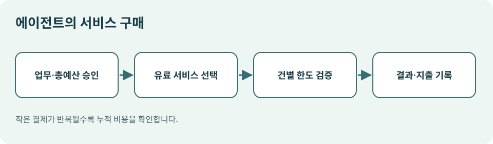

# 10. 에이전트가 디지털 서비스에 돈을 낼 때

> 확인일: 2026년 11월 9일. 아래 제품 사례는 시범 운영과 조기 접근 범위를 설명합니다. 2027년 전망은 확인된 현재 사실과 구분해 읽어 주세요.

## 장면: 한 일을 끝내려면 다른 서비스 두 곳이 필요합니다

광고팀이 AI에 새 간식의 홍보안을 부탁합니다. AI는 소비자 반응을 조사할 외부 데이터 서비스와 홍보 이미지를 만들 도구가 필요합니다. 기존에는 각 서비스의 계정, 계약, 선불 크레딧이 있어야 했습니다. 에이전트가 작업 중 필요한 서비스를 발견하고 정해진 예산에서 사용료를 낼 수 있다면, 한 작업이 여러 서비스를 거쳐 이어질 수 있습니다.

이때의 구매자는 사람이 쇼핑하는 화면과 다릅니다. **에이전트가 다른 디지털 서비스를 이용하고 비용을 지불하는 거래**입니다. 이 장에서는 이를 ‘에이전트 간 거래’ 또는 ‘기계 간 결제’라고 부르겠습니다.

*그림: 이 책을 위해 직접 제작한 에이전트 서비스 구매 도식.*

| 사람의 온라인 쇼핑 | 에이전트의 디지털 서비스 구매 |
| --- | --- |
| 상품 상세 페이지를 읽음 | 서비스의 사용 조건과 가격 정보를 읽음 |
| 장바구니에 물건을 담음 | 필요한 데이터·모델·도구 호출을 계획함 |
| 배송을 기다림 | 호출 결과를 받아 다음 작업에 사용함 |
| 주문번호·영수증을 확인함 | 사용 내역·호출 결과·결제 기록을 확인함 |

두 경우 모두 ‘누가, 무엇을, 얼마에, 어떤 허락으로 샀는가’가 중요합니다. 디지털 서비스는 거래가 매우 작고 자주 일어날 수 있어서 **한 번의 큰 한도만으로는 충분하지 않습니다.**

## 2026년의 시범 사례

마스터카드는 2026년 10월 20일 Agent Pay for Machines의 시험 사례와 개발자 대상 조기 접근을 공개했습니다. 발표에 따르면 한 마케팅 회사가 업무와 예산을 먼저 승인했고, 에이전트는 조사 서비스와 이미지 생성 서비스에 작업 중 비용을 냈습니다. 발표된 시범에서는 두 판매자에 걸쳐 9건의 결제가 일어났습니다. 이것은 **시범 시연과 조기 접근**이며, 어느 기업이나 바로 사용할 수 있는 보편적 결제망이 완성되었다는 의미는 아닙니다. [Mastercard 발표](https://www.mastercard.com/global/en/news-and-trends/press/2026/october/Mastercard-Agent-Pay-for-Machines-in-action.html)

마스터카드는 이 흐름에서 서비스가 결제를 요청하고, 에이전트가 허용 범위 안에서 전자 서명된 지급 증표를 만들며, 제공자가 이를 확인한 뒤 서비스를 제공한다고 설명합니다. 사용 내역을 모아 나중에 정산할 수도 있습니다. 원리를 이해하려면 기술 이름보다 **사전 승인 → 서비스 선택 → 비용 요청 → 한도 검증 → 결과와 지출 기록** 순서를 기억하면 됩니다. [Mastercard 발표](https://www.mastercard.com/global/en/news-and-trends/press/2026/october/Mastercard-Agent-Pay-for-Machines-in-action.html)

## 여러 작은 결제에서 생기는 새로운 질문

| 질문 | 운영 규칙 예시 |
| --- | --- |
| 같은 목적에 서비스를 몇 개까지 쓸 수 있나요? | 한 작업당 승인된 서비스 3개 이내 |
| 결과가 나쁘면 비용은 어떻게 하나요? | 유료 호출 전 샘플·품질 기준 확인 |
| 가격이 갑자기 오르면요? | 예상 단가보다 20% 높으면 중단 |
| 재시도할 때 다시 돈이 나가나요? | 호출 식별자와 지출 기록을 비교 |
| 사내 자료가 외부 서비스로 나가나요? | 데이터 분류에 따라 사용처 제한 |

예를 들어 500원짜리 데이터 조회는 작아 보입니다. 그러나 AI가 결과를 개선하려고 1,000번 반복하면 50만 원입니다. 반대로 예산을 너무 작게 잡으면 작업이 중간에 멈춰 실제 업무에 쓸 수 없는 결과만 남을 수 있습니다. **건당 한도, 총 예산, 호출 횟수, 중단 조건**을 함께 정해야 합니다.

## 좋은 실험은 돈보다 증거부터 설계합니다

조직이 2027년을 준비한다면 실제 결제 없이 시험용 예산표부터 만들어 볼 수 있습니다. 업무 하나를 정하고, 에이전트가 어떤 유료 서비스를 왜 선택했는지 기록하게 합니다. 사람이 적어 둔 대안과 결과 품질을 비교합니다. 그다음 모의 비용을 계산해 예상했던 예산과 다른 지점을 찾습니다.

| 기록 항목 | 남기는 이유 |
| --- | --- |
| 작업 목적 | 지출이 목적에 맞는지 확인 |
| 서비스와 판매자 | 누구에게 자료와 돈이 갔는지 확인 |
| 사용 단가·횟수 | 작은 거래의 누적 비용 확인 |
| 결과물과 품질 | 비용 대비 유용성 평가 |
| 승인자와 한도 | 권한의 근거 확인 |

이 기록이 있어야 ‘에이전트가 일을 끝냈다’라는 주장과 실제 가치가 연결됩니다. 앞으로 결제 프로토콜이 발전해도, 맡긴 일의 결과와 비용을 함께 보는 습관은 그대로 필요합니다.

**이번 장의 핵심:** 에이전트 간 거래는 디지털 서비스를 작업 중에 조합할 수 있게 하지만, 작은 결제의 반복과 데이터 전달을 통제해야 합니다. 2027년의 실무 과제는 자동 결제 자체보다 **업무 목적에 맞는 지출을 설명할 수 있는 기록**입니다.
