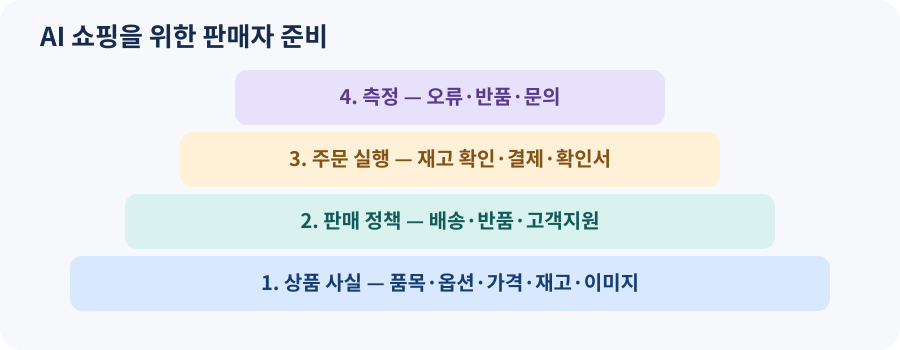

# 12. 판매자가 준비할 것

> 집필 기준: 2026년 11월 9일. 서비스별 제공 국가와 가입 조건은 변할 수 있습니다. 여기서는 판매자가 통제할 수 있는 상품 정보와 주문 운영을 중심으로 설명합니다.

## 고객이 매장에 오기 전

예전에는 고객이 검색 결과를 보고 쇼핑몰에 들어와 상세 페이지를 읽었습니다. 이제는 고객이 AI에게 “비 오는 날 출퇴근용으로 가벼운 신발을 골라 줘”라고 묻고, AI가 여러 판매자의 상품을 먼저 비교할 수 있습니다. 판매자 입장에서는 **상품 페이지가 열리기 전부터 설명이 시작**되는 셈입니다.

OpenAI는 2026년 3월 상품 발견을 위한 Agentic Commerce Protocol(ACP)을 확대하면서 판매자가 상품 피드와 프로모션 정보를 제공할 수 있게 했습니다. Google 역시 Universal Commerce Protocol(UCP)과 Merchant Center를 통한 판매자 참여를 넓히고 있습니다. 두 프로토콜은 이름이 비슷하지만 서로 다른 생태계와 구현입니다. 판매자가 한 곳에 등록하면 모든 AI 쇼핑 서비스에 자동으로 연결되는 것은 아닙니다. [OpenAI 발표](https://openai.com/index/powering-product-discovery-in-chatgpt/) · [Google UCP 업데이트](https://blog.google/products-and-platforms/products/shopping/ucp-updates/)

*그림 12-1. 자체 제작 도식. AI에 보이는 상품 정보부터 주문 후 운영까지 이어지는 판매자 준비 순서입니다.*

## 첫 단계는 상품 데이터의 정확성입니다

AI가 상품을 잘 설명하려면 이름, 규격, 재고, 가격, 이미지, 판매자, 배송·반품 조건을 읽을 수 있어야 합니다. OpenAI의 상품 피드 규격은 구매 가능한 품목이나 옵션마다 한 행을 두고, 안정적인 품목 ID를 사용하도록 안내합니다. 색상과 크기가 다른 옵션을 하나의 모호한 상품명에 섞으면 고객이 보던 물건과 결제할 물건이 달라질 수 있습니다. [OpenAI 상품 데이터 규격](https://developers.openai.com/commerce/specs/file-upload/products)

| 고객의 질문 | 판매자가 제공해야 할 사실 | 운영 점검 |
| --- | --- | --- |
| “내 발에 맞나요?” | 크기, 소재, 치수 기준 | 옵션별 정보가 실제 재고와 연결되는가 |
| “오늘 살 수 있나요?” | 재고 상태, 판매 가능 지역 | 품절 변경이 빠르게 반영되는가 |
| “총 얼마인가요?” | 상품 가격, 배송비, 세금 표시 기준 | 최종 결제액과 차이가 나는가 |
| “반품할 수 있나요?” | 반품 가능 기간과 예외 | 상세 페이지·주문 확인서와 일치하는가 |
| “누가 파나요?” | 판매자명과 고객지원 창구 | 마켓플레이스의 여러 판매자가 구분되는가 |

표의 각 행은 AI를 위한 특수한 문구가 아닙니다. 사람 고객에게도 필요한 사실입니다. 핵심은 여러 화면과 데이터 파일에 흩어진 정보가 **서로 다른 답을 하지 않게** 만드는 것입니다. 한 화면에서는 재고 있음, 다른 곳에서는 품절이라고 한다면 AI 노출을 늘릴수록 불만도 커질 수 있습니다.

## ‘발견’과 ‘결제’를 구분합니다

상품이 AI의 답변에 소개되는 것과 AI 안에서 결제가 완료되는 것은 별개의 단계입니다. OpenAI의 개발자 문서는 상품 검색용 데이터 제공과 결제 연동을 구분하며, Instant Checkout은 승인된 파트너에 제공된다고 설명합니다. 상품 피드에 결제 가능 표시를 넣는 것만으로 결제 기능이 켜지는 것도 아닙니다. [OpenAI ACP 주요 개념](https://developers.openai.com/commerce/guides/key-concepts) · [상품 피드 규격](https://developers.openai.com/commerce/specs/file-upload/products)

판매자는 현재 고객이 어디에서 결제를 마치는지 먼저 정리해야 합니다. AI가 상품을 추천하고 판매자 사이트로 보낸다면 기존 결제 흐름의 장바구니·쿠폰·배송비 계산이 중요합니다. 플랫폼 안에서 결제하는 연동이라면 주문 생성, 세금과 재고 확인, 결제 거절, 주문 확인을 판매자 시스템이 정확히 처리해야 합니다. OpenAI의 ACP 설명에서도 실제 주문 상태와 결제 처리는 판매자 시스템에서 이루어지고, 판매자가 주문을 수락하거나 거절합니다. [OpenAI ACP 주요 개념](https://developers.openai.com/commerce/guides/key-concepts)

## 노출 순위보다 오류율을 먼저 봅니다

많은 판매자가 “AI 검색에서 우리 상품이 보이나?”를 가장 먼저 묻습니다. 중요한 질문이지만, 노출만을 목표로 잡으면 품절·가격 오류·반품 분쟁을 놓칠 수 있습니다. 초기 운영에서는 다음 지표를 함께 봐야 합니다.

| 지표 | 무엇을 알려 주나 | 문제가 보이면 |
| --- | --- | --- |
| 상품 정보 누락률 | AI가 기본 사실을 읽을 수 있는가 | 옵션·가격·이미지 누락 수정 |
| 가격·재고 불일치율 | 추천과 결제 사이 정보가 어긋나는가 | 갱신 주기와 원천 데이터 확인 |
| AI 유입 후 결제 완료율 | 발견이 실제 구매로 이어지는가 | 배송비·옵션 선택 장애 확인 |
| 오주문·반품 사유 | AI 설명이 기대와 달랐는가 | 상품 문구와 선택 기준 수정 |
| 고객 문의 해결 시간 | 새 구매 경로의 지원 체계가 작동하는가 | 주문 번호와 유입 경로 연결 |

Google은 2026년 9월 일부 국가의 Merchant Center에서 AI 노출 관련 성과 정보를 일반 제공한다고 발표했습니다. 이 기능은 **호주·캐나다·인도·뉴질랜드·미국**에 대한 발표였으므로 한국 판매자에게 똑같이 열려 있다고 가정하면 안 됩니다. 판매자는 자기 계정에서 실제 제공 범위를 확인해야 합니다. [Google, 2026년 9월 16일](https://blog.google/products-and-platforms/products/shopping/google-shopping-updates-holiday-shopping/)

## 판매자 팀의 역할 나누기

상품 담당자는 규격과 사진을, 운영 담당자는 재고·배송·반품을, 결제 담당자는 주문 실패와 환불을, 고객지원 담당자는 고객의 실제 질문을 관리합니다. AI 쇼핑은 이 정보를 한꺼번에 보여 주므로 어느 한 팀의 자료만 맞아서는 부족합니다. 매주 대표 상품 10개를 골라 **AI가 요약한 설명 → 실제 상세 페이지 → 결제 화면 → 주문 확인서**를 이어서 확인해 보세요. 문제를 발견하면 “AI가 틀렸다”로 끝내지 말고 어느 원천 정보부터 고쳐야 하는지 기록합니다.

### 이번 장의 점검표

- 옵션별 품목 ID, 가격, 재고, 이미지가 맞나요?
- 배송비와 반품 조건이 상세 페이지와 주문 확인서에서 일치하나요?
- 상품 발견과 결제 연동의 가입·제공 범위를 구분했나요?
- AI 유입 고객의 문의와 오주문 사유를 추적할 수 있나요?
- 판매자가 최종 주문을 거절하거나 수정할 기준이 있나요?

다음 장에서는 구매하는 사람이 어떤 범위까지 AI에게 맡기고, 무엇을 직접 확인해야 하는지 살펴봅니다.
