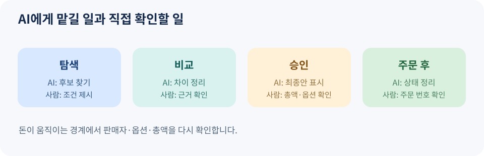

# 13. 소비자가 맡기고 확인할 것

> 집필 기준: 2026년 11월 9일. 서비스의 구매·결제 기능은 국가와 계정, 판매자에 따라 다릅니다. 이 장의 대화 예시는 사용법을 설명하기 위한 가상 사례입니다.

## 쇼핑을 맡기는 세 단계

AI에게 “우리 집에 맞는 공기청정기를 찾아 줘”라고 말하는 것과 “오늘 결제까지 끝내 줘”라고 말하는 것은 다릅니다. 앞의 요청은 정보 탐색이고, 뒤의 요청은 금전 행동입니다. 두 요청 사이에 **후보 비교**와 **최종 승인**이라는 단계가 필요합니다.

*그림 13-1. 자체 제작 도식. 소비자가 각 단계에서 AI에게 맡길 일과 직접 확인할 일을 표시했습니다.*

| 단계 | AI에게 맡길 일 | 사람이 확인할 일 |
| --- | --- | --- |
| 탐색 | 후보 찾기, 사양·가격 모으기 | 목적과 필수 조건 알려 주기 |
| 비교 | 장단점과 제외 이유 정리 | 근거 링크와 빠진 조건 확인 |
| 결제 준비 | 최종 옵션·총액 보여 주기 | 판매자·배송지·환불 조건 승인 |
| 주문 후 | 주문 내역과 배송 상태 정리 | 실제 주문 번호·결제 명세 확인 |

탐색과 비교에서는 AI의 속도가 도움이 됩니다. 반면 최종 결제 정보는 사람이 한눈에 검토할 수 있어야 합니다. 특히 수량, 크기, 구독 여부, 배송지는 작은 차이가 실제 손실로 이어집니다. 주문 후에는 AI의 “완료했습니다”라는 문장보다 **판매자의 주문 번호와 결제 사업자의 명세**를 우선 확인합니다.

## 좋은 요청은 상품명보다 생활 조건이 구체적입니다

“공기청정기 추천”만으로는 선택 기준이 부족합니다. 다음처럼 말하면 AI가 무엇을 제외해야 하는지도 알 수 있습니다.

> “원룸에서 밤에 사용할 공기청정기 세 가지를 찾아 주세요. 예산은 배송비 포함 20만 원 이하, 소음 정보가 확인되는 제품만 포함해 주세요. 필터 교체 비용과 반품 가능 여부를 비교하고, 정보가 확인되지 않으면 ‘미확인’이라고 표시해 주세요. 결제는 하지 마세요.”

이 요청에는 목적, 예산, 필수 조건, 불확실성 표시, 행동 제한이 모두 있습니다. 같은 방식으로 육아용품이라면 안전 기준과 연령, 식품이라면 알레르기 성분, 출장 예약이라면 취소 가능 조건을 넣어야 합니다. AI가 빠뜨리기 쉬운 조건을 사용자가 먼저 알려 주는 것이 오구매를 줄이는 가장 현실적인 방법입니다.

OpenAI의 쇼핑 도움말은 상품 결과가 질문과 문맥을 바탕으로 선택되며, 일부 상품·판매자에 한해 ChatGPT 안에서 바로 결제할 수 있다고 설명합니다. 도움말은 판매자 정보가 제삼자 또는 판매자가 직접 제공한 자료에서 올 수 있고, 가격·재고·품질 등의 요소가 판매자 표시 순서에 영향을 줄 수 있다고 안내합니다. 그러므로 AI에 보이는 첫 결과를 객관적 ‘정답’으로 받아들이지 말고, 구매 목적에 맞는지 직접 검토해야 합니다. [OpenAI 쇼핑 도움말](https://help.openai.com/en/articles/11128490-improved-shopping-results-from-chatgpt-search)

## 결제 전 30초 확인 카드

결제 화면이 나타나면 아래 항목을 순서대로 읽습니다. AI가 자동으로 채운 칸일수록 눈으로 확인합니다.

| 항목 | 확인 질문 | 흔한 실수 |
| --- | --- | --- |
| 상품·옵션 | 필요한 모델·크기·색상인가요? | 비슷한 모델 선택 |
| 판매자 | 믿을 수 있는 판매자인가요? | 다른 판매자에게 주문 |
| 총액 | 배송비·세금·할인 후 얼마인가요? | 표시 가격만 보고 승인 |
| 횟수 | 이번 한 번인가요, 정기결제인가요? | 구독 시작을 놓침 |
| 배송지 | 주소와 수령인이 맞나요? | 저장된 옛 주소 사용 |
| 사후 처리 | 취소·교환·반품 조건이 무엇인가요? | 주문 후에야 제한 확인 |

이 카드는 AI 서비스가 보장하는 절차가 아니라 소비자가 스스로 적용할 수 있는 점검 방식입니다. 결제 화면이 위 정보를 보여 주지 않으면 판매자 페이지로 이동해 확인하거나, 결제를 미루는 것이 낫습니다.

## 맡기지 않는 편이 좋은 경우

의약품, 어린이 안전 장비, 고가의 중고품, 여행 일정이 복잡한 예약처럼 실수 비용이 큰 구매에는 더 많은 검토가 필요합니다. AI가 후보를 정리하는 데 도움을 줄 수는 있지만, 조건의 적합성을 전문가·제조사·판매자에게 별도로 확인할 수 있습니다. 이 판단은 상품 종류와 사용자의 상황에 따라 달라집니다.

또한 결제 수단을 연결할 때는 그 에이전트가 실제로 필요한 권한만 부여합니다. 구매가 끝나면 연결 상태와 정기결제 여부를 확인합니다. Mastercard가 설명하는 에이전트 결제 구상은 사용자가 허락한 범위와 인증을 토큰에 연결하고 취소할 수 있도록 설계합니다. 다만 이것이 모든 쇼핑 앱의 현재 기능이라는 뜻은 아닙니다. [Mastercard 설명 자료](https://www.mastercard.com/content/dam/mccom/eu/news-and-trends/business-thought-leadership/digital-payments/pdfs/Get_ready_for_AI-powered_shopping_experiences.pdf)

### 이번 장의 점검표

- 목적·예산·필수 조건·제외 조건을 AI에게 말했나요?
- 추천의 근거와 확인되지 않은 정보를 구분했나요?
- 결제 직전 최종 옵션, 판매자, 총액, 배송지, 정기결제 여부를 확인했나요?
- 주문 번호와 결제 명세를 실제로 받았나요?
- 취소·환불이 필요할 때 어디에서 신청하는지 알고 있나요?

다음 장에서는 개인의 쇼핑을 넘어, 조직이 에이전틱 커머스를 도입할 때 90일 동안 무엇을 실험하고 평가할지 정합니다.
