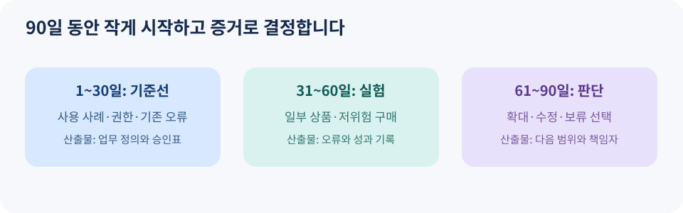

# 14. 조직의 90일 도입 계획

> 집필 기준: 2026년 11월 9일. 이 90일 계획은 책의 실무 제안입니다. 표준이나 특정 서비스가 요구하는 의무 일정이 아닙니다.

## 먼저 어떤 문제를 풀지 정합니다

한 쇼핑몰이 “AI 쇼핑을 시작하자”고 결정했다고 해 보겠습니다. 상품 피드를 어느 플랫폼에 올릴지부터 정하면, 정작 고객이 원하는 정보가 틀려 있는 문제를 놓칠 수 있습니다. 반대로 한 제조사가 구매 담당자의 정기적인 소모품 발주를 자동화하고 싶다면, 광고 노출보다 승인·예산·거래 기록이 먼저입니다. **판매자와 구매자의 목표는 다릅니다.**

이 책은 NIST의 AI 위험 관리 프레임워크가 제시하는 네 기능, 즉 관리(Govern)·상황 파악(Map)·측정(Measure)·대응(Manage)을 도입 계획의 틀로 참고합니다. NIST는 이 틀을 자발적으로 활용하도록 제시하며, 모든 조직이 같은 절차를 밟아야 한다고 규정하지 않습니다. [NIST AI RMF](https://www.nist.gov/itl/ai-risk-management-framework) · [NIST 실무 가이드](https://airc.nist.gov/airmf-resources/playbook/)

*그림 14-1. 자체 제작 도식. 30일 단위의 산출물을 연결한 실무 계획입니다.*

## 1~30일: 범위와 기준선

첫 달에는 기능을 많이 붙이지 않습니다. 판매자라면 대표 상품군 하나를, 구매 조직이라면 반복 구매하는 저위험 품목 하나를 고릅니다. 한 번의 주문에 관여하는 사람과 시스템을 그려 보고, **누가 가격을 바꾸고 누가 주문을 승인하며 누가 환불을 처리하는지** 적습니다.

| 해야 할 일 | 남길 산출물 | 통과 조건 |
| --- | --- | --- |
| 대표 사용 사례 선택 | 한 페이지 업무 정의 | 상품·고객·지역·채널이 좁게 정해짐 |
| 기존 오류 조사 | 가격·재고·오주문 사례 20건 | 현재 실패 패턴을 설명할 수 있음 |
| 권한 경계 합의 | 승인표와 예산 상한 | 결제·배송지 변경의 승인자가 명확함 |
| 데이터 상태 확인 | 상품 정보 표본 점검 | 필수 항목과 원천 시스템이 확인됨 |
| 중단 방법 정리 | 연결 해제·주문 중지 절차 | 담당자가 실제로 실행할 수 있음 |

여기서 ‘통과 조건’은 모든 문제를 고친 상태가 아닙니다. **무엇이 문제인지 측정할 수 있는 상태**입니다. 첫 달에 기준선을 남겨야 다음 달의 개선이 실제인지 판단할 수 있습니다.

## 31~60일: 제한된 실험

두 번째 달에는 읽기 중심 실험부터 시작합니다. 판매자라면 상품 피드의 일부를 검증하고 AI에 소개되는 설명과 실제 상세 페이지를 비교합니다. 구매자라면 AI가 후보를 찾고 비교표를 작성하게 하되, 결제는 사람이 직접 합니다. 충분한 기록이 쌓인 뒤에만 제한된 금액의 결제 시나리오를 시험합니다.

테스트에는 성공 사례뿐 아니라 실패 사례도 넣습니다. 예를 들어 재고가 방금 품절된 상품, 이름이 비슷한 다른 규격, 반품 불가 상품, 배송비가 커서 예산을 초과하는 장바구니를 준비합니다. AI가 어떤 답을 하는지뿐 아니라 **실제 주문이 차단되는지** 확인해야 합니다. OWASP는 에이전트의 도구 오용과 과도한 권한, 외부 입력에 의한 목표 변경 등을 주요 위험으로 분류합니다. [OWASP 에이전트 보안 위험](https://genai.owasp.org/resource/owasp-top-10-for-agentic-applications-for-2026/)

| 실험 항목 | 측정값 예시 | 검토 주기 |
| --- | --- | --- |
| 가격·재고 정확도 | 실제 화면과 AI 표시의 불일치 건수 | 매주 |
| 선택의 적합성 | 필수 조건을 놓친 추천 비율 | 매주 |
| 승인 품질 | 승인 화면에서 발견된 오류 건수 | 매주 |
| 주문 안전성 | 중복 주문·초과 결제 건수 | 발생 즉시 |
| 지원 부담 | AI 유입 고객 문의 유형과 처리 시간 | 매주 |

숫자 하나만 좋아졌다고 확대하지 않습니다. 노출이 늘면서 오주문도 늘었다면 고객 경험은 악화될 수 있습니다. 구매 완료율과 함께 취소·환불·문의 비용을 봐야 합니다.

## 61~90일: 확대 또는 보류를 결정합니다

마지막 달에는 역할별로 결과를 검토합니다. 상품팀은 정보 품질을, 결제팀은 거래·환불을, 고객지원팀은 실제 불만을, 보안팀은 권한과 기록을 봅니다. 테스트 결과를 바탕으로 **확대·수정 후 재시험·보류** 중 하나를 결정합니다.

| 결정 | 가능한 조건 | 다음 행동 |
| --- | --- | --- |
| 확대 | 핵심 오류가 줄고 중단 절차가 작동함 | 한 상품군 또는 한 지역씩 추가 |
| 수정 후 재시험 | 특정 옵션·재고 동기화 문제 | 원천 정보 수정, 같은 테스트 반복 |
| 보류 | 결제 통제나 주문 증거가 부족함 | 결제 자동화를 멈추고 탐색만 운영 |

이 판단표의 목적은 무조건 확대하는 것이 아닙니다. 실험 범위와 실제 권한을 맞추는 것입니다. 특히 주문·결제는 한 번 실행되면 고객과 판매자 모두에게 후속 비용을 남깁니다.

### 회의에서 남길 결정 기록

“어떤 상품군과 지역에서, 어느 에이전트에게, 얼마까지, 무엇을 승인받아, 어떤 지표가 충족되면 확대하는가?”를 한 문단으로 기록하세요. 담당자가 바뀌어도 같은 기준으로 판단할 수 있습니다. 90일 계획이 끝난 뒤에도 월별로 오류·분쟁·상품 정보의 변화를 확인해야 합니다.

다음 장에서는 여기까지 확인한 사실을 토대로 2027년의 가능성을 세 가지 시나리오로 나눠 봅니다.
