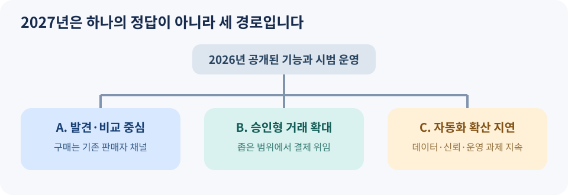

# 15. 2027년의 세 가지 시나리오와 관찰 지표

> **기준일: 2026년 11월 9일.** 이 장의 2027년 내용은 예측이나 확정된 출시 계획이 아니라, 현재 공개된 기능과 시범 운영을 바탕으로 만든 **시나리오**입니다. 이후의 실제 결과는 다를 수 있습니다.

## 이제 무엇을 기다려야 할까요?

2026년에는 AI가 상품을 발견하고 비교하는 기능이 넓어졌습니다. Google은 판매자용 Universal Commerce Protocol(UCP) 기능을 확장했고, OpenAI는 Agentic Commerce Protocol(ACP)을 상품 발견에 활용한다고 밝혔습니다. 결제 쪽에서는 Visa가 승인된 기업 청구서 결제의 시범 운영을, Mastercard가 에이전트 간 디지털 서비스 결제의 조기 접근을, Stripe가 사업자의 에이전트 금융 업무 기능을 발표했습니다. 이 발표들은 **같은 제품의 단계별 출시가 아니라 서로 다른 회사의 별도 접근**입니다. [Google UCP](https://blog.google/products-and-platforms/products/shopping/ucp-updates/) · [OpenAI ACP](https://openai.com/index/powering-product-discovery-in-chatgpt/) · [Visa 시범 운영](https://usa.visa.com/about-visa/newsroom/press-releases.releaseId.22856.html) · [Mastercard 조기 접근](https://www.mastercard.com/global/en/news-and-trends/press/2026/october/Mastercard-Agent-Pay-for-Machines-in-action.html) · [Stripe 에이전트 금융](https://stripe.com/en-de/newsroom/news/treasury-for-agents)

*그림 15-1. 자체 제작 도식. 2027년을 하나의 정답 대신 세 가지 가능한 경로로 읽는 방법입니다.*

## 시나리오 A: 발견과 비교가 가장 먼저 보편화됩니다

고객은 AI에게 조건을 말하고 후보를 비교하지만, 결제는 판매자 사이트나 기존 앱에서 마칩니다. 판매자에게 중요한 일은 상품 피드의 정확성, 설명의 일치, 연결 뒤의 결제 경험입니다. 이 경로는 새로운 결제 권한을 크게 늘리지 않아도 시작할 수 있습니다.

이 시나리오를 지지하는 현재 근거는 상품 발견에 대한 투자가 이미 진행 중이라는 점입니다. OpenAI는 2026년 3월 제품 발견 기능을 확대하면서, 초기 Instant Checkout이 기대한 유연성을 제공하지 못해 판매자 자체 결제 경험을 허용하고 상품 발견에 더 집중한다고 설명했습니다. 따라서 “곧 모든 쇼핑이 AI 창 안에서 끝난다”고 단정할 근거는 없습니다. [OpenAI, 2026년 3월 24일](https://openai.com/index/powering-product-discovery-in-chatgpt/)

## 시나리오 B: 승인형 거래가 일부 영역에서 확대됩니다

AI가 상품을 고르고 결제까지 준비하되, 사람이 최종 금액과 판매자를 승인합니다. 기업 구매에서는 정해진 공급자, 반복 품목, 예산 상한이 있는 경우부터 확산될 수 있습니다. Visa의 2026년 10월 시범 운영은 승인된 구매자의 청구서 결제를 에이전트가 공급자 포털에서 처리하는 사례입니다. 이를 모든 기업에 배포된 기능으로 읽어서는 안 됩니다. [Visa, 2026년 10월 20일](https://usa.visa.com/about-visa/newsroom/press-releases.releaseId.22856.html)

소비자 구매에서도 신원과 구매 의도를 증명하는 기술이 중요해집니다. Visa는 Trusted Agent Protocol의 상용 범위가 개발·배포 중이며 시장별 차이가 있을 수 있다고 밝힙니다. Mastercard의 Agent Pay for Machines도 2026년 10월 기준 조기 접근입니다. 이런 상태를 보면 2027년에는 **승인과 한도를 분명히 한 좁은 사용 사례**가 먼저 늘어날 가능성이 있습니다. 이는 자료에 근거한 이 책의 추론입니다. [Visa 개발자 문서](https://developer.visa.com/capabilities/trusted-agent-protocol) · [Mastercard, 2026년 10월 20일](https://www.mastercard.com/global/en/news-and-trends/press/2026/october/Mastercard-Agent-Pay-for-Machines-in-action.html)

## 시나리오 C: 자동화가 생각보다 천천히 퍼집니다

고객이 AI의 비교는 좋아해도 결제 권한은 주지 않을 수 있습니다. 판매자마다 상품 데이터가 다르고, 국가별 결제·소비자 보호 규칙이 다르며, 오구매가 생겼을 때 책임 소재가 불명확할 수 있습니다. 이 경우 2027년의 성과는 자동 결제 건수보다 **정확한 추천, 반품 감소, 고객 문의 개선**에서 먼저 보일 수 있습니다.

이 시나리오는 실패가 아닙니다. AI가 상품을 찾는 데 도움이 되면서도 사람의 확인이 유지되는 방식일 수 있습니다. 기술이 가능하다고 해서 모든 구매에 같은 수준의 자율성을 적용해야 하는 것은 아닙니다.

| 관찰 지표 | A가 강해지는 신호 | B가 강해지는 신호 | C가 강해지는 신호 |
| --- | --- | --- | --- |
| 이용자 행동 | AI 유입·비교 사용 증가 | 승인 뒤 결제 완료 증가 | 비교 후 기존 채널로 복귀 |
| 판매자 준비 | 상품 피드 확대 | 주문·결제 연동 확대 | 데이터 오류와 운영 비용 증가 |
| 신뢰 | 정확한 정보 요구 증가 | 신원·권한·분쟁 체계 정착 | 오구매·사기 우려 지속 |
| 공개 범위 | 여러 국가의 검색 제공 | 시범 운영이 일반 제공으로 전환 | 지역·파트너 제한 장기화 |

표에서 어느 칸이 먼저 나타나는지 한 달 단위로 확인해 보세요. 서로 다른 시나리오가 함께 일어날 수도 있습니다. 예를 들어 식품 구매는 기존 앱 결제가 유지되고, 기업의 반복 소모품 주문은 승인형 자동화가 늘어날 수 있습니다. 모든 시장이 같은 속도로 움직인다고 가정할 필요는 없습니다.

## 독자가 2027년에 할 수 있는 일

소비자라면 AI가 추천한 상품의 **조건·판매자·총액·반품 방법**을 직접 확인하고, 결제 권한을 최소한으로 줍니다. 판매자라면 상품명보다 **가격·재고·옵션·정책의 일치**를 먼저 개선합니다. 조직에서 구매를 맡기는 사람이라면 **예산, 승인, 주문 기록, 중단 방법**을 문서로 남깁니다.

이 책의 출발점은 “AI가 어디까지 대신 살 수 있는가?”였습니다. 마지막 질문은 조금 다릅니다. **“무엇을 맡겨야 고객과 판매자 모두 더 정확하고 안전한 결정을 할 수 있는가?”** 2027년의 흐름을 읽을 때도 이 질문을 기준으로 삼으면, 새 기능이 나올 때마다 흔들리지 않고 실제 가치를 판단할 수 있습니다.

### 한 장으로 남기는 최종 점검표

- 현재 발표된 기능과 2027년 전망을 구분하고 있나요?
- 상품 발견, 구매 승인, 결제 실행을 각각 측정하고 있나요?
- 가격·재고·옵션과 실제 주문 결과를 대조할 수 있나요?
- 사람의 승인과 에이전트의 지출 한도가 분명한가요?
- 사고가 나면 누가 추가 결제를 중단하고 고객을 돕나요?

새 기능이 발표될 때마다 이 다섯 질문을 다시 확인하면, 에이전틱 커머스를 유행어가 아니라 운영 가능한 일로 이해할 수 있습니다.
